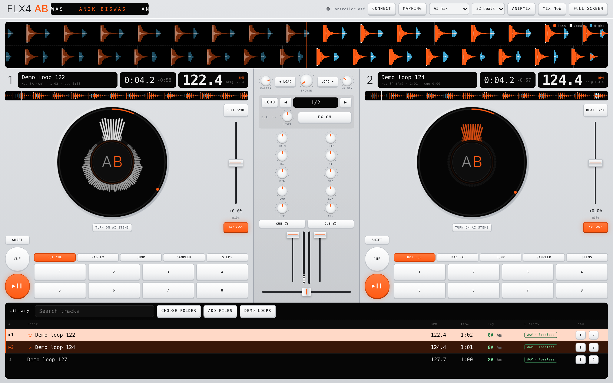

# FLX4 AB

A browser DJ app for the Pioneer DJ **DDJ-FLX4** controller, with an offline AI auto-mixer.
Everything runs in one HTML file in Chrome or Edge. No install, no server, no account.

> **Status: experimental.** Built for learning to mix at home. Every feature has been tested with simulated
> controller messages and synthetic audio, but not yet widely on real hardware or real music libraries.
> Reviews, bug reports and pull requests are very welcome. See [How you can help](#how-you-can-help).

## Try it

1. Download [`index.html`](index.html) and open it in **Chrome or Edge** (Safari and Firefox can't talk to MIDI controllers).
2. Quit rekordbox or Serato, then plug in the FLX4.
3. Click **Connect** and allow MIDI access.
4. Click **Choose folder** and pick a folder of music. Your files never leave your computer.
5. Load a track on each deck and press **Mix now**, or press **ANIKMIX** to let it build a set.

No controller? It works with the mouse too, and **Demo loops** gives you something to play.

## Features

**Decks and mixer**
- Two decks laid out like the FLX4: jog/visualizer, tempo slider, Beat Sync, Cue, Play, Shift, pad modes
- 3-band EQ, trim, CFX filter, channel faders with meters, crossfader, headphone cue (4-channel output)
- Scrolling 3-band waveforms (bass / vocals / highs) and track overviews
- Key lock (time-stretch), high-quality resampling, transparent lookahead limiter
- Real scratching: touch-sensitive jog, 720 ticks per turn at 33⅓ RPM

**Pads**
- Hot cues, Pad FX (rekordbox default bank: Roll, Sweep, Flanger, V.Brake, Echo, Reverb, Echo out),
  Beat jump, Sampler, Stems
- Effects act on press and wind down on release

**Library**
- BPM, musical key (Camelot), length and source quality for every track
- Leading and trailing silence trimmed automatically
- The playing track is highlighted

**AI mixing (offline)**
- Analyses each song's tempo, key, structure (intro, drops, outro), vocals and energy
- **AI mix** plans each transition: where the new song enters, blend length, where the bass swaps,
  and how to avoid vocal or key clashes. It explains each decision on screen
- **ANIKMIX** picks the next song by tempo, key and energy, and mixes at the current song's outro
- Optional **AI stems**: separates vocals, drums, bass and melody with
  [HTDemucs](https://github.com/facebookresearch/demucs) running in the browser via
  [onnxruntime-web](https://onnxruntime.ai/). About 75 MB downloaded once, then fully offline.
  Stem-aware mixes bring in the new drums first and hand vocals over cleanly
- More transition styles: Bass swap, Vocal swap, Filter fade, Echo out, Loop roll, Brake drop,
  Reverb wash, Spinback, Double drop

**Controller**
- Default mapping for the DDJ-FLX4, written from documentation and simulated messages
- **Mapping → Learn** remaps any control; the last MIDI message is shown in the library bar
- Button lights and channel level meters are sent back to the controller

## How you can help

The most useful things right now:

1. **Test with a real DDJ-FLX4.** Which buttons, knobs and lights don't respond or do the wrong thing?
   Please include the MIDI line shown at the bottom right of the library when you press the control.
2. **Judge the AI mixes on real music.** Which transitions sound good, and which sound off? Track
   genres, BPMs and keys help a lot.
3. **AI stems on your machine.** Does it start? GPU or CPU? How long per song? Any errors?
4. **Code review.** The app is one large HTML file. Ideas for structure, audio-engine correctness,
   performance or accessibility are welcome.

Open an [issue](../../issues/new/choose) or a pull request. See [CONTRIBUTING.md](CONTRIBUTING.md).

## Known limitations

- Chrome/Edge only, because of Web MIDI.
- Tempo, key and drop detection are good but not perfect, especially with live drums or tempo changes.
- AI stems can take several minutes per song on CPU, and use a lot of memory.
- The DDJ-FLX4 mapping has not been verified on every firmware version.
- Not a replacement for rekordbox or Serato at a gig.

## Credits and licences

- Code: MIT licence, see [LICENSE](LICENSE).
- Stems model: HTDemucs by Meta AI (MIT), ONNX conversion by the
  [demucs-onnx](https://pypi.org/project/demucs-onnx/) project. Downloaded at runtime, not included here.
- Runtime: [onnxruntime-web](https://github.com/microsoft/onnxruntime) (MIT), loaded from jsDelivr.

This is an independent project. It is not affiliated with or endorsed by Pioneer DJ or AlphaTheta.
"DDJ-FLX4" and "rekordbox" are trademarks of their owners.
